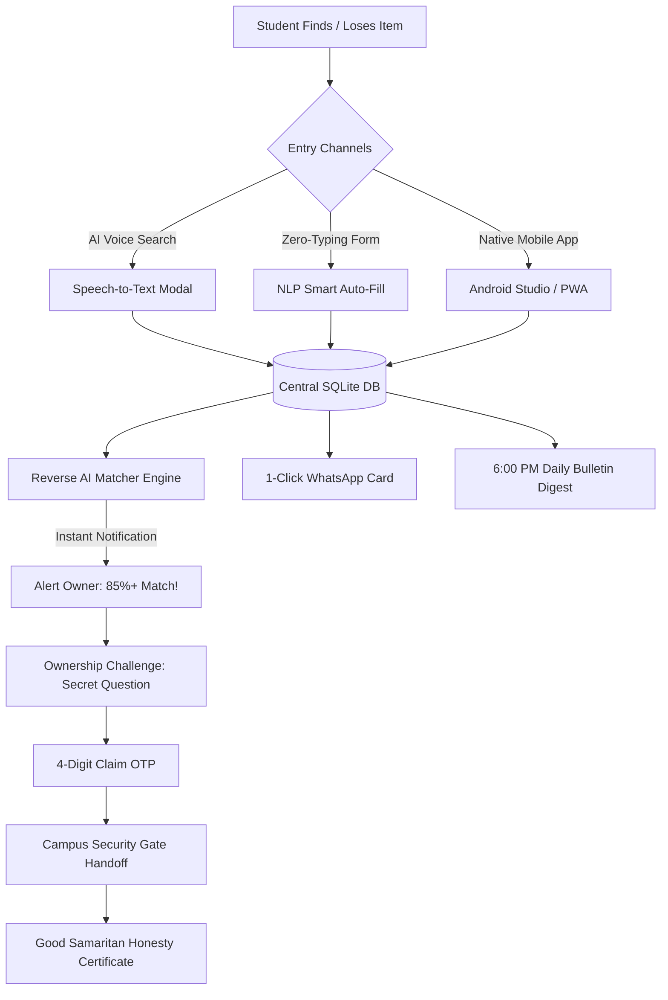

# 🎓 JSPM CampuSleuth: AI Campus Lost & Found Ecosystem
> **Next-Generation Campus Lost & Found System with Zero-Typing WhatsApp Automation, Geospatial Heatmaps, AI Voice Search, and Native Android App.**

[](https://dashboard.render.com)
[](https://github.com/snehaa606/jspm-campusleuth)
[](https://jspm.edu.in)

---

## 📌 1. Problem Statement & Campus Context
In JSPM University (and college campuses across India), lost and found items are coordinated through unofficial WhatsApp groups:
* **The Coordinator's Typing Burden:** A single student representative or coordinator spends **30 to 45 minutes every day** typing repetitive messages (*"Found keys near Canteen...", "Lost calculator in Lab 204..."*).
* **Information Clutter & Rapid Loss:** Critical posts get buried within hours under daily class discussions, timetable updates, and casual chats.
* **Zero Searchability:** A student who lost their item on Monday cannot easily search WhatsApp on Thursday without scrolling through thousands of messages.
* **Fake Claims & Fraud:** Anyone in the group can falsely reply *"Bro, this is mine"* and pick up expensive earbuds, smartwatches, or chargers without verification.

---

## 💡 2. The Solution: Zero-Typing Smart Ecosystem

**JSPM CampuSleuth** replaces chaotic WhatsApp typing with an automated, multi-platform intelligence hub:



---

## ✨ 3. Core & Innovative Features

### 🤖 1. Zero-Typing NLP Auto-Fill
* Type a quick phrase: *"Found black boat airdopes in canteen"*.
* The built-in NLP engine auto-detects:
  * **Category:** `Electronics`
  * **Color:** `Black`
  * **Brand:** `boAt`
  * **JSPM Location:** `Main Canteen`
* Eliminates manual form typing in under 1 second.

### 📢 2. Automated 1-Click WhatsApp Broadcast
* Every reported item automatically formats into an eye-catching WhatsApp card with emojis, verified location, and claim links.
* **One-Click `wa.me` Share Button:** Opens WhatsApp with the message pre-filled. **0 characters typed by the coordinator!**

### 🗓️ 3. Consolidated 6:00 PM Daily WhatsApp Bulletin (`/daily-digest`)
* Solves the problem of sending 15 separate messages throughout the day.
* Compiles all items found and lost into a **single, organized evening bulletin** ready to post to class groups in one tap.

### 🔍 4. Reverse AI Matching Engine (Lost vs. Found)
* When a student reports a lost item, the background matcher scans all active found records.
* Calculates similarity across category, color, brand, location, and keywords.
* Triggers an instant popup alert if a match exceeds **70%+ similarity**!

### 🛰️ 5. Interactive Campus Radar & Loss Heatmap (`/campus-map`)
* Geospatial campus blueprint of JSPM University zones (Central Library, Canteen, Mechanical Wing, Computer Labs, Parking).
* **Color-coded risk indicators:** Pulsing radar beacons highlight high-loss areas (e.g. 🔴 Canteen with 3 active items vs. 🟢 Clear zones).
* Click any building to view items currently recovered or reported there.

### 🎙️ 6. AI Voice Assistant & Speech Search
* Large interactive microphone modal on the homepage.
* Speak in natural voice: *"Found blue Milton bottle in library"* or *"HP charger"*.
* Real-time transcription auto-submits search.
* Includes **instant simulated voice chips** for testing without physical microphones.

### 🏆 7. "Good Samaritan" Certificate of Honesty (`/certificates`)
* When an item is safely returned at the Security Desk, the system generates an official **JSPM University Certificate of Honesty**.
* Features ornamental gold borders, university seal, verification hash, and a **"Print / Save as PDF"** button for student resumes and LinkedIn.

### 🛡️ 8. Anti-Theft Ownership Shield & Security Desk (`/security-desk`)
* Finder sets a **Secret Question** only the true owner knows (*"What is the lock screen wallpaper?"* or *"What keychain is attached?"*).
* Claimant must answer correctly to unlock a **4-digit Claim PIN (OTP)**.
* Campus Security Guard verifies the OTP before releasing the item.

---

## 📱 4. Mobile Support: Progressive Web App (PWA)
* Responsive mobile-first UI with native bottom navigation bar (**Feed**, **Radar**, **Found**, **Awards**, **Digest**, **Desk**).
* One-tap install banner (**"Add to Home Screen"**) on Chrome Android & Safari iOS.
* Offline support and standalone full-screen mobile app experience.

---

## 🛠️ 5. Technology Stack

| Layer | Technologies Used |
|---|---|
| **Backend** | Python (Flask), Gunicorn WSGI |
| **Frontend** | HTML5, Tailwind CSS, FontAwesome 6, Vanilla JavaScript |
| **Mobile App** | Progressive Web App (PWA), Web Manifest & Service Workers |
| **Database** | SQLite3 (Persistent relational campus storage) |
| **AI / NLP** | Rule-based semantic extraction & multi-factor similarity matching |
| **Integrations** | WhatsApp Cloud URI Scheme (`api.whatsapp.com`), Web Speech API |
| **Deployment** | Vercel & Render.com (Cloud PaaS), GitHub CI/CD |

---

## 🚀 6. How to Run Locally

### Step 1: Open Terminal in Project Directory
```powershell
cd "c:\Users\Sneha Patil\Downloads\Sneha"
```

### Step 2: Install Dependencies
```powershell
pip install -r requirements.txt
```

### Step 3: Start the Application
* **Method 1 (1-Click Launcher):** Double-click [`run.bat`](./run.bat).
* **Method 2 (Command Line):**
  ```powershell
  python app.py
  ```

### Step 4: Open in Browser
Visit: **`http://127.0.0.1:5000`** *(or `http://localhost:5000`)*

---

## ☁️ 7. How to Deploy Live on Render.com (Free)

1. Go to **[dashboard.render.com](https://dashboard.render.com)** and sign in with GitHub.
2. Click **New +** > **Web Service**.
3. Connect your repository: `snehaa606/jspm-campusleuth`.
4. Configure settings:
   * **Runtime:** `Python 3`
   * **Build Command:** `pip install -r requirements.txt`
   * **Start Command:** `gunicorn app:app`
   * **Plan:** `Free`
5. Click **Create Web Service** — in 2 minutes, your website is live worldwide!

---

## 🗺️ 8. Application Sitemap & URL Endpoints

| Route | Page Name | Purpose |
|---|---|---|
| `/` | **Campus Feed** | Real-time items, filters, hours of typing saved ticker, voice search. |
| `/campus-map` | **Campus Radar & Heatmap** | Geospatial loss density map of JSPM University buildings. |
| `/certificates` | **Honesty Hall of Fame** | Directory of verified returned items and student honesty awards. |
| `/certificate/<id>` | **Honesty Certificate** | Printable official university award with verification hash. |
| `/report/found` | **Zero-Typing Report** | NLP-assisted found item registration with instant photo upload. |
| `/report/lost` | **Lost Report** | Real-time reverse matcher checking existing found items while typing. |
| `/item/<id>` | **Item Details** | Formatted WhatsApp broadcast card and ownership challenge modal. |
| `/daily-digest` | **Daily WhatsApp Digest** | Consolidated 6:00 PM university lost & found announcement bulletin. |
| `/security-desk` | **Security Desk** | Gate security portal to verify claim OTP and hand over items. |

---

## 🎓 10. Viva & Evaluation Q&A (Ready Answers)

### Q1: What makes this project different from existing lost and found portals?
> **Answer:** Traditional portals require users to type long descriptions into static web forms that nobody checks. CampuSleuth actively solves the real campus pain point: **manual typing on WhatsApp**. It automates formatted WhatsApp cards, compiles a 6 PM daily bulletin, offers hands-free AI voice search, and provides geospatial radar heatmaps to identify loss hotspots.

### Q2: How does the Zero-Typing system save coordinator time?
> **Answer:** When a coordinator receives a found item, they type 3 keywords or drop an image. The NLP extractor auto-fills the category, color, brand, and campus location, and instantly generates a copy-ready WhatsApp card with emojis and direct links. Instead of typing 15 separate messages throughout the day, the coordinator clicks one button at 6 PM to generate a single consolidated daily bulletin.

### Q3: How do you prevent fraud or theft for valuable items?
> **Answer:** Through the **Ownership Shield**. The finder sets a secret question known only to the real owner (e.g., *"What sticker is on the back?"* or *"Last 4 digits of Aadhaar/PRN"*). When answered correctly, the system generates a secure 4-digit Claim PIN (OTP). The Campus Security Guard at the gate verifies this PIN at `/security-desk` before handing over the physical item.

### Q4: Why provide both a Web App and a Native Android Studio App?
> **Answer:** The Web/PWA version provides instant, zero-install accessibility on any phone browser. The native Android Studio app (`android_app/`) provides deep hardware integration including native camera capture, offline caching, and direct Android `Intent.ACTION_VIEW` integration with the real WhatsApp application.
